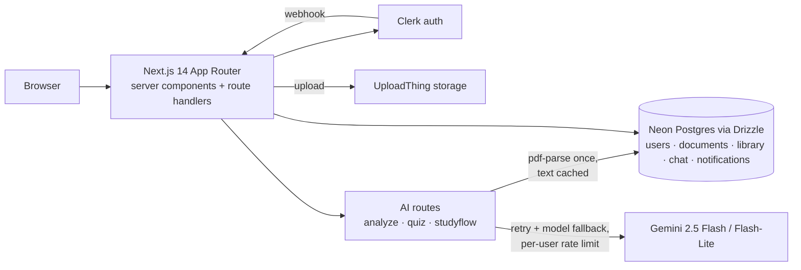

<div align="center">

<h1>GrindFlow</h1>

Peer‑powered study notes platform built with Next.js, TypeScript, Tailwind, Neon, Drizzle, Clerk, and UploadThing.

<p>
  <a href="https://github.com/puravbhatt0504/grindflow"></a>
  
  
  
  
  
  
  
</p>


</div>

## What it is

Students upload their notes as PDFs. GrindFlow scores and critiques them with Gemini, turns them into quizzes and step-by-step study flows, and lets students publish good notes to a shared public library and discuss them in chat rooms.

Built by a team of five (see [Team](#-team)).

## ✨ Features

- **AI note review:** `/api/analyze` extracts the PDF text once (cached in `documents_text`), then asks Gemini for a score and a written critique, stored with the document.
- **Quizzes and study flows:** `/api/quiz` and `/api/studyflow` generate practice questions and adaptive study steps from the same cached text.
- **Public library:** submit, browse, view and download notes others have shared.
- **Chat:** rooms, `@username` mentions and notifications (`/api/chat/*`, `/api/notifications`).
- **Auth and profiles:** Clerk (Google OAuth + email), usernames, Clerk webhook to sync users.
- **Resilient AI calls:** `lib/gemini.ts` retries with backoff (0.5 s → 6 s), falls back across Gemini models, and stops early on non-retryable errors; `lib/rate-limit.ts` is a per-user token bucket on every AI route (`429` with rate-limit headers).

## 🏗️ Architecture



The rate limiter is in memory, so on serverless it limits per instance rather than globally; a shared store (e.g. Redis) would be the next step under real load.

## 📦 Tech Stack

| Layer | Technology |
|---|---|
| Framework | Next.js 14 App Router (server components + server actions) |
| Language | TypeScript 5, ESLint |
| Styling | Tailwind CSS |
| Database | Neon (serverless Postgres) + Drizzle ORM |
| Auth | Clerk |
| Storage | UploadThing |
| AI | Google Gemini 2.5 Flash / Flash-Lite |
| UI extras | framer‑motion, sonner |

## 🔄 Migration Summary (complete)

The project has been fully migrated off Supabase in three phases:

| Phase | What changed | Branch commit |
|---|---|---|
| Phase 1 | Supabase Postgres → **Neon + Drizzle ORM** | `004b3b3` |
| Phase 2 | Supabase Auth → **Clerk** | `2b6d293` |
| Phase 3 | Supabase Storage → **UploadThing** | `2b6d293` |
| Post-migration | Per-user rate limiting + Gemini retry helper | `8dd183f` |
| Gemini upgrade | `gemini-1.5-*` → `gemini-2.5-flash-lite`; API path `v1` → `v1beta` | latest |

Supabase is no longer a dependency.

## 🚀 Getting Started

### Prerequisites

- Node.js 18+
- npm or yarn

### Installation

1. Install dependencies:
```bash
npm install
```

2. Create `.env.local` with the following variables:

**Database (Neon):**
- `DATABASE_URL` - Neon connection string (pooled)
- `DATABASE_URL_UNPOOLED` - Direct connection string (for migrations)

**Authentication (Clerk):**
- `NEXT_PUBLIC_CLERK_PUBLISHABLE_KEY`
- `CLERK_SECRET_KEY`
- `NEXT_PUBLIC_CLERK_SIGN_IN_URL` (e.g. `/sign-in`)
- `NEXT_PUBLIC_CLERK_SIGN_UP_URL` (e.g. `/sign-up`)

**Storage (UploadThing):**
- `UPLOADTHING_SECRET`
- `UPLOADTHING_APP_ID`

**AI:**
- `GEMINI_API_KEY` - Google Gemini API key

**GitHub (server-only, optional):**
- `GITHUB_TOKEN` - Used to fetch team avatars on `/about`

> Variables prefixed with `NEXT_PUBLIC_` are exposed to the browser. Never expose secret keys with that prefix.

3. Run migrations:
```bash
npx drizzle-kit push
```

4. Start the dev server:
```bash
npm run dev
```

5. Open [http://localhost:3000](http://localhost:3000) in your browser.

## 🧭 Project Structure

```
grindflow/
├── app/
│   ├── api/
│   │   ├── analyze/ quiz/ studyflow/      # AI routes (Gemini)
│   │   ├── documents/ text/ uploadthing/  # uploads and extracted text
│   │   ├── public-library/                # submit, view, download
│   │   ├── chat/ notifications/           # rooms, messages, mentions
│   │   ├── user/ webhooks/clerk/          # usernames, Clerk user sync
│   │   └── health/
│   ├── dashboard/ explore/ chat/ public-upload/ onboarding/ about/
│   ├── login/ signin/ sso-callback/       # Clerk auth pages
│   └── layout.tsx, page.tsx
├── components/
├── drizzle/                               # migrations
├── lib/
│   ├── db/                                # Neon + Drizzle client and schema
│   ├── gemini.ts                          # retry, backoff, model fallback
│   ├── rate-limit.ts                      # per-user token bucket
│   └── auth.ts, text.ts, mentions.ts, uploadthing.ts
└── public/
```

## 🛡️ Image domains

External images used by Next/Image are configured in `next.config.js`:

- `avatars.githubusercontent.com`
- `ui-avatars.com`

## 🧪 Scripts

- `npm run dev` - Start development server
- `npm run build` - Build for production
- `npm run start` - Start production server
- `npm run lint` - Run ESLint
- `npx drizzle-kit push` - Push schema changes to Neon
- `npx drizzle-kit studio` - Open Drizzle Studio (DB browser)

## 🔗 Official Repository

- Project code: [puravbhatt0504/grindflow](https://github.com/puravbhatt0504/grindflow)

## 🙌 Team

- Purav Bhatt — Project Coordinator — GitHub: `puravbhatt0504`
- Shreya Jha — Full Stack developer and lots of moral support — GitHub: `whoshrey`
- Devyani Dadawal — AI Lead & Full Stack developer — GitHub: `devyanidadwal`
- Piyush Thakur — Flutter Developer (Mobile apps) — GitHub: `Piyush-Fr`
- Tushar Kaushik — Full Stack developer — GitHub: `Tusharkaushik1106`

## License

ISC
